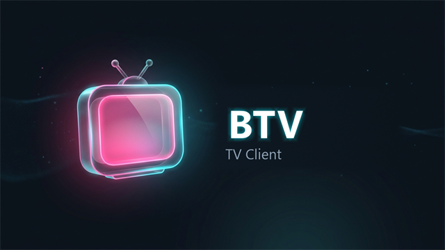

<div align="center">



# BTV

**哔哩哔哩第三方 Android TV 客户端架构重构版**

[-informational?logo=android)](https://apilevels.com/#:~:text=Jetpack%20Compose%20requires%20a%20minSdk%20of%2021%20or%20higher)
[](https://kotlinlang.org)
[](https://developer.android.com/jetpack/compose)
[](https://developer.android.com/media/media3)
[](./LICENSE)

**BTV 不支持在中国大陆地区内使用，如有相关使用需求请使用 [云视听小电视](https://app.bilibili.com)**

</div>

---

## 📖 项目简介

BTV 是基于 [BV](https://github.com/aaa1115910/bv) 重构的 [哔哩哔哩](https://www.bilibili.com) 第三方 `Android TV` 客户端。基于 **Jetpack Compose for TV** 打造，全面遵循 **10-foot Leanback** 电视交互体验基准。

**这不是原版 BV 的 1:1 复刻，而是一次由内而外的架构重构与交互升级。** 在继承原版轻量无广告、画质自由切换等核心体验的基础上，引入了现代 Android 架构规范，大幅增强了大屏交互细节与系统稳定性。

> 💡 原版 BV 历史源码保留在本仓库的 [`bv-feature`](../../tree/bv-feature) 分支。

---

## ✨ 核心特性与体验升级

### 📺 10-foot 沉浸式电视交互
- **自动响应式侧边导航抽屉**：遵循电视大屏交互规范，焦点移入自动平滑展开、移出收起为迷你图标栏，既保留宽阔的浏览视野，又提供触手可及的导航切换。
- **首页「精选」综合泳道**：支持「为你推荐」、「热门视频」、「我的动态」多泳道并存，通过顶部 Filter Chips 实现秒级分类定位，配合平滑垂直滚动算法，杜绝焦点跳转时的屏幕剧烈抖动。
- **即点即播优先设计**：卡片短按默认直接全屏播放，告别冗余的中间详情页等待；保留一键直达详情与分 P 选集通道。
- **统一卡片操作菜单（Action Dialog）**：任意卡片长按或按遥控器 `Menu` 键呼出统一快捷面板，支持进入详情、稍后再看、关注/取关 UP 主、查看 UP 空间、番剧追番等常用操作。

### 🎬 强劲播放引擎与防烧屏保护
- **全格式 Media3 播放内核**：支持 DASH 视频流、8K/4K/1080P 高码率、HDR、杜比视界与杜比全景声，音视频多码率智能同步。
- **防烧屏微光漂浮屏保（Screensaver）**：针对 OLED/大屏电视设计的微光屏保系统，全黑像素背景结合微光时间、日期与当前视频信息，每 30 秒随机平滑漂移，有效预防长时间暂停导致的烧屏；任意按键或触摸即刻秒级唤醒。
- **轻量沉浸下推式 OSD 控制器**：播放控制器采用分层下推式半透明设计，不遮挡画面主体；支持三连动效（长按一键三连）、分段弹幕加载与云端字幕解析。
- **相关视频悬浮抽屉**：播放过程中一键呼出当前视频相关推荐，无需退回主页即可连续观影。

### 🔍 大屏搜索优化
- **双栏无缝联动布局**：左侧内置大屏专用全键盘/九宫格/拼音首字母软键盘，右侧实时展示分栏搜索结果与热搜词。
- **快捷键直达筛选**：搜索结果流中随时按 `Menu` 菜单键或点击右上角呼出筛选面板，支持按播放量、弹幕数、投稿时间等维度秒级重排。
- **热搜词收展偏好**：支持自定义展开或收起热搜推荐词，设置状态自动持久化。

### 📡 直播与社区互动
- **全功能直播体验**：推荐、分区、关注与直播榜单，支持 HLS/FLV 多线路无缝切换、WebSocket 实时弹幕渲染与人气统计。
- **大屏弹窗评论区**：支持热门/最新排序、无限滚动加载与楼中楼展开，播放器内即可查看精彩评论。
- **触控与遥控器双模自适应**：电视端遥控器 D-Pad 优先；若运行在触屏电视、平板或投影仪上，自动支持触控滑动手势（进度调节、亮度、音量）。

### 🛠 诊断与系统稳定性
- **LRU 缓存智能管理**：支持 50MB ~ 500MB 可调缓存阈值及自动淘汰，集成数据占用查看与手动一键清理。
- **结构化日志与局域网诊断**：内置局域网 Web 日志服务，手机/PC 浏览器直连即可查看 TV 运行日志，方便网络排障；全面完善本地崩溃捕获。

---

## 🏛 架构设计

BTV 遵循现代 Android 开发架构标准：

```
BTV/
├── app/               # 主应用（UI、ViewModel、Compose Navigation 路由）
├── core/              # 核心基础库（主题配色、焦点扩展、KeyEvent 工具）
├── data/              # 持久化数据层（Room、DataStore、用户偏好 Prefs）
├── bili-api/          # B 站 HTTP API 与 gRPC 客户端封装（纯 Interface 契约隔离）
├── bili-api-grpc/     # Protobuf 定义与生成代码
├── bili-subtitle/     # 字幕解析与编码（BCC / SRT）
├── player/            # Media3 播放器抽象与控制封装
├── danmaku/           # 弹幕业务抽象与蒙版支持
└── danmaku-engine/    # 高性能弹幕渲染引擎（基于 AkDanmaku）
```

- **单 Activity + Navigation Compose**：全应用单一 Activity 架构，页面流转依托类型安全路由（`@Serializable Route`）。
- **单向数据流（UDF）**：ViewModel 统一通过 `StateFlow` 暴露不可变 UI 状态，Compose 使用 `collectAsStateWithLifecycle()` 保证生命周期安全。
- **结构化并发保障**：全异步加载统一遵循 `withTimeout` 与 `CancellationException` 重抛规范，结合 `try-finally` 保证 loading 状态绝对可靠复位。
- **模块化契约解耦**：Repository 均提取为纯 Kotlin 接口与伴生工厂函数，隔离内部实现细节，全面消除单元测试中的网络穿透与假 Mock 隐患。
- **依赖注入**：全模块接入 Google Hilt，杜绝手动单例耦合。

---

## 📊 性能表现

在 TV 1080p 模拟器（x86 / API 28）、Release 混淆构建环境下与原版 BV 对比：

| 指标 | BTV | 原版 BV | 表现提升 |
|---|---|---|---|
| **冷启动 → 首页首帧** | 576 ms | 1076 ms | **快 46.5%**（约 1.87×） |
| **Release APK 体积** | 7.20 MiB | 11.97 MiB | **小 39.8%**（约 1.66×） |
| **静态分析代码规范** | ktlint 100% 通过 | - | 严谨的 ASCII 字母序与零未使用 import |
| **测试套件保障** | 单元测试全量通过 | 覆盖率较低 | 覆盖平滑滚动算法、游标保持、并发传播等核心链路 |

---

## 🛠 构建与运行

### 环境要求
- **JDK 17**（需设置 `JAVA_HOME` 指向 JDK 17 安装路径）
- **Android SDK**（compileSdk 36, minSdk 21）
- **Kotlin 2.4.10**

### 常用命令
```bash
# 编译 Debug APK
./gradlew assembleDebug

# 运行所有 JVM 单元测试
./gradlew test

# 运行特定模块单元测试
./gradlew :app:testDebugUnitTest
./gradlew :bili-api:test

# 执行代码风格检查 (ktlint)
./gradlew ktlintCheck

# 自动格式化代码风格
./gradlew ktlintFormat
```

---

## 📚 详细文档

- [PRD 文档](docs/PRD.md) — 完整功能需求规格说明与架构设计
- [开发计划](docs/开发计划.md) — 各版本里程碑分解与验收标准
- [AGENTS.md](AGENTS.md) — AI 协作开发规范、编码准则与排障手册

---

## 🙏 致谢

- [aaa1115910/bv](https://github.com/aaa1115910/bv) — 本项目源自原版 BV 项目的架构探索与重构
- [cat3399/blbl](https://github.com/cat3399/blbl) — 部分网络接口实现与弹幕加载逻辑参考
- [akdanmaku](https://github.com/Frost819/AkDanmaku) — 弹幕渲染引擎内核支持

---

## 📄 License

本项目基于 [MIT License](LICENSE) 开源发布。
