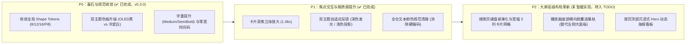

# BTV 界面与视觉系统（UI/UX）全景优化建议书

> 本文档针对 BTV 客户端的大屏交互与视觉表现进行系统性梳理，遵循 **10-foot Leanback** 电视交互体验标准（参考 YouTube TV、Apple TV tvOS 17 与 Material 3 for TV），并严密覆盖 **深色（Dark）与浅色（Light）双主题系统**，为后续 UI 体验迭代提供清晰的技术与设计指引。

---

## 1. 总体设计原则

| 维度 | 设计基准 | 核心原则 |
|---|---|---|
| **视距标准** | 10-foot（约 3 ~ 4 米视距） | 远距离一眼可辨，字重与对比度必须充足 |
| **操控介质** | 遥控器 D-Pad 方向键为主 | 强调焦点的物理存在感与移动反馈流畅度 |
| **双主题兼顾** | 深色（夜间/沉浸）+ 浅色（日间高亮客厅） | 深浅两套色彩配方，禁止全仓硬编码暗黑或纯白 |
| **显示载体** | 大尺寸 4K / 1080P OLED / Mini-LED / LCD 电视 | 深色极致纯黑防漏光，浅色冷瓷柔光防刺眼 |
| **交互核心** | 沉浸式与直达性 | 减少厚重弹窗遮挡，选集与设置轻量化悬浮 |

---

## 2. 四大维度优化建议

### 一、UI 布局优化（大屏视线流动与沉浸感）

#### 1. 首页：引入「沉浸式 Hero 动态海报看板（Showcase Banner）」
- **现状分析**：当前首页顶部直接展开 Filter Chips 胶囊和横向卡片泳道，整体排版较为紧密，但缺少大屏电视独有的“视觉焦点”。
- **改进方案**：
  - 在精选页顶部设立全屏宽幅的 **Hero Showcase** 动态高光区；
  - 遥控器焦点移入任意视频卡片并停留 400ms 后，背景自动平滑渐变透出该视频的高清封面、剧照截帧、动态大字标题、UP 主、播放统计与简介；
  - 提供大尺寸「立即起播」与「进入详情」快捷操作，营造家庭影院级的沉浸观感。

#### 2. 播放器：将左侧厚重选集面板升级为「底部横向胶囊选集轨」
- **现状分析**：目前在播放视频时呼出分集列表（`VideoListController`），是从屏幕左侧滑入一个宽达 300dp 的竖向遮罩面板，遮挡了将近 1/3 的画面内容。
- **改进方案**：
  - 采用轻量级**下推式交互**；
  - 播放中按遥控器「上」或「下」方向键，仅在屏幕底部展开一条水平滑动的**分 P / 集数胶囊微轨**；
  - 附带微型缩略图与分集标题，当前播放集自动高亮居中；选集切换时主画面几乎不被遮挡。

#### 3. 搜索页：重塑左右栏比例与键盘自适应
- **现状分析**：目前搜索页左栏固定放置全字母软键盘，横向占用宽度过大（约 40%），导致右侧搜索结果卡片的展示空间被挤压，视频卡片偏小且文字拥挤。
- **改进方案**：
  - 优化左栏占宽至约 28% ~ 30%，引入「T9 九宫格拼音简拼」或紧凑型键盘；
  - 右侧视频结果网格扩展为 3 列宽幅卡片，提供更大的封面面积与更舒展的元数据展示空间。

---

### 二、菜单与文本排版（10-foot 远距可读性标准）

#### 1. 字重提升与字距调校（Tracking & Weight）
- **现状分析**：目前大量辅助信息直接采用 `bodySmall` 或 `labelSmall` 的 Regular 字重，在低色域或大尺寸电视上面板发虚，远距离阅读易产生疲劳。
- **改进方案**：
  - **核心元数据（UP 主名称、播放量、弹幕数）**：由 Regular 统一提升为 **Medium（500）**；
  - **核心标题（视频名、卡片标题）**：统一采用 **SemiBold（600）~ Bold（700）**；
  - **字距微调**：英文与数字增加 `letterSpacing = 0.5.sp`，中文保持自然舒展，大幅提升远距离瞬间扫读舒适度。

#### 2. 时间码与数值等宽对齐（Tabular Figures）
- **现状分析**：播放器下方的实时播放时间（如 `01:23 / 45:10`）和倍速浮动提示在时间跳动时，因非等宽字符导致数字宽度频繁微变，产生微弱的水平视觉抖动。
- **改进方案**：
  - 为播放时间码、弹幕数量、视频时长引入等宽字体特性（`FontFeatureSettings("tnum")`，Tabular Numbers）；
  - 彻底消除数字跳动时的水平排版抖动。

---

### 三、色彩体系与双主题适配（深色 Dark 与浅色 Light）

BTV 设置项支持「跟随系统 / 深色模式 / 浅色模式」，因此色彩体系必须全面兼顾黑白双主题，杜绝硬编码颜色。

#### 1. 深浅双主题设计配方对照表

| 设计维度 | 深色主题（Dark Mode） | 浅色主题（Light Mode） | 架构实现约束 |
|---|---|---|---|
| **背景底色（Background）** | **True OLED 微蓝黑** `#090D16` ~ `#0C101A` （高对比、通透、暗场纯黑） | **雅致冷瓷白 / 雾面灰** `#F4F6FA` （杜绝纯白 `#FFFFFF` 导致大屏过曝刺眼） | 禁止硬编码 `Color.Black`，由 `MaterialTheme.colorScheme.background` 派生 |
| **卡片/容器（Surface）** | **深空微透黑** `rgba(255, 255, 255, 0.05)` 微弱磨砂质感 | **纯白悬浮面板** `#FFFFFF` 与冷瓷白底形成轻量对比悬浮 | 绑定 `MaterialTheme.colorScheme.surface` |
| **前景色阶（文字）** | **纯白不透明阶梯** • 一级：`#FFFFFF` (100%) • 二级：`rgba(255,255,255,0.75)` • 三级：`rgba(255,255,255,0.50)` | **深靛/石板灰阶梯** • 一级标题：`#111827` (近黑 100%) • 二级正文：`#4B5563` (石板灰 75%) • 三级弱文本：`#9CA3AF` (冷灰 50%) | 禁止硬编码 `Color.White`，统一使用 `onSurface` / `onSurfaceVariant` |
| **焦点获焦反馈 (Focus)** | **极光呼吸发光（Neon Glow）** 1.06x 放大 + 电光青/粉紫光晕 | **环境弥散投影（Drop Shadow）** 1.06x 放大 + 柔和加深阴影 + 品牌色加粗外框 | 封装 `tvFocusFeedback()` Modifier，内部读取 `isDark` 自动切换 Glow 或 Shadow |
| **播放器全屏沉浸特例** | **默认深色** | **强制/嵌套深色**（全屏观影时 OSD 防刺眼暗场） | 播放器外围遵从全局，但全屏播放界面内部固定包裹 `BVTheme(ThemeMode.Dark)` |

#### 2. 深色模式细节：OLED 深度幽蓝黑与极光流光
- 根背景采用深度幽蓝黑（`#090D16` ~ `#0C101A`），在 OLED 面板上黑色像素彻底关闭，通透纯粹且大幅省电；
- 获焦态引入 B 站标志性的 **电光青（#00F5FF）与柔光粉（#FA5383）** 作为点睛呼吸光晕。

#### 3. 浅色模式细节：冷瓷雅致白与立体微投影
- 根背景避免使用刺眼的 `#FFFFFF` 纯白大反光，采用低反光冷瓷灰白 `#F4F6FA`；
- 内容卡片与悬浮抽屉使用纯白 `#FFFFFF`，在底色之上自然形成层次分明的悬浮卡片；
- 获焦态通过弥散阴影（Drop Shadow）与品牌色（`#5E5A8B`）边框锁定焦点位置。

---

### 四、边框形状与焦点质感（Shape Tokens 与三维反馈）

#### 1. 建立全局统一的 Shape Tokens（终结圆角碎片化）
- **现状分析**：当前全仓圆角值高度分散（存在 `3.dp`、`4.dp`、`8.dp`、`10.dp`、`12.dp`、`16.dp`、`18.dp`、`20.dp`、`50%` 等多达十几种定义），视觉缺乏统一律动感。
- **改进方案**：收敛并确立四大标准 Shape Tokens（黑白主题完全通用）：

| Token 名称 | 圆角规格 | 适用场景 |
|---|---|---|
| `Shape.Small` | `8.dp` | 微型标签（Tag）、清晰度角标、时间指示微标 |
| `Shape.Medium` | `12.dp` | 功能按钮、抽屉导航项、菜单列表行、设置项 |
| `Shape.Large` | `16.dp` | 视频卡片、弹窗对话框、功能浮层卡片 |
| `Shape.Pill` | `50%`（全圆角胶囊） | 筛选胶囊（Filter Chips）、快捷按键圆形徽章 |

#### 2. 从「平面单线框」进化为「三维立体双态焦点体系」
- **现状分析**：目前卡片获焦主要依赖描边 `border(2.dp, PrimaryLight)`，属于扁平化反馈，远距离操作时缺乏立体感。
- **改进方案**：打造电视端标准的**三维焦点联动体验**：
  1. **物理放大（Scale）**：获焦卡片整体以平滑弹簧曲线放大 `1.05x ~ 1.08x`，邻近卡片自动微微避让；
  2. **双态氛围反馈**：
     - **深色模式**：投射青紫色极光晕影（Ambient Glow），视线焦点极易捕捉；
     - **浅色模式**：投射悬浮投影（Drop Shadow）+ 加深轮廓线，对比清晰醒目；
  3. **微渐变/高对比边框**：边框随主题明暗呈现精致光泽感。

---

## 3. 落地实施演进路线（Roadmap）

> **说明**：P2 阶段涉及大屏高级布局与核心控制器交互重构，改动范围大，当前已暂缓并详细归档至 [TODO.md](../TODO.md)，待后续作为独立特性单独排期开发。

---

## 4. 各阶段工作量评估与任务拆解

以标准人天（Man-Days，1 人天 = 8 小时全职开发 + 自测）为单位评估：

| 阶段 | 状态 | 优化项 | 涉及核心文件/模块 | 复杂度 | 预估工期 | 风险点与避坑指南 |
|---|---|---|---|---|---|---|
| **P0** | **✅ 已完成** | **1. 全局 Shape Tokens 收敛** | `core/theme/BVTheme.kt` 全仓各 UI 组件 (~54 处) | **低** | **0.5 ~ 1 人天** | 需全仓替换硬编码的 `RoundedCornerShape(4.dp/8.dp)`，重点检查卡片外沿与封面图片裁切边界是否越界溢出。 |
| **P0** | **✅ 已完成** | **2. 字体排版与等宽数字** | `core/theme/Typography.kt` `VideoProgressSeek.kt` `ControllerVideoInfo.kt` | **低** | **0.5 ~ 1 人天** | 在 `BVTypography` 中补齐 Medium/SemiBold 字重与字距；为时间码等高频刷新文本注入 `FontFeatureSettings("tnum")`。低风险高收益。 |
| **P0** | **✅ 已完成** | **3. 双主题色板升级与文字色阶** | `core/theme/Color.kt` `core/theme/BVTheme.kt` 各 Screen 标题/副标题 | **中** | **1 ~ 1.5 人天** | 重点排查业务组件中是否存在写死 `Color.White` 或 `Color.Black` 的情况，确保切换浅色主题时自动变为高对比深靛灰。 |
| **P1** | **✅ 已完成** | **4. 双主题自适应获焦微动效** | `core/focus/TvFocusFeedback.kt` `SmallVideoCard.kt` 等卡片 | **中** | **2 ~ 2.5 人天** | 封装跨组件通用的 `TvFocusDefaults` / `Modifier.tvFocusFeedback`：深色模式绘制 Glow 发光，浅色模式绘制 Elevation 投影与加粗轮廓。 |
| **P2** | **⏳ 待办 (TODO)** | **5. 搜索页紧凑键盘与宽网格** | `ui/screen/search/SearchInputContent.kt` | **中** | **1.5 ~ 2 人天** | 调整左右分栏权重（键盘宽度由 40% 缩减至 28~30%），右侧视频卡片网格从 2 列升为 3 列，需重点调试遥控器在键盘与网格之间的自然寻焦。 |
| **P2** | **⏳ 待办 (TODO)** | **6. 播放器底部横向胶囊选集轨** | `ui/component/player/VideoListController.kt` `VideoPlayerController.kt` | **高** | **2 ~ 3 人天** | 替代原本左侧 300dp 的大竖向抽屉，重构为底部水平微轨。需处理：当前播放集自动居中滚动、遥控器上/下键的呼出与隐藏、进度条协同。 |
| **P2** | **⏳ 待办 (TODO)** | **7. 首页 Hero Showcase 沉浸看板** | `ui/screen/home/HomeScreen.kt` 新组件 `HomeHeroBanner.kt` | **高** | **3 ~ 3.5 人天** | 典型大屏体验组件：卡片获焦需 400ms 防抖避免频繁切换背景海报、大图渐变淡入淡出、低内存设备 Bitmap 释放与复用。 |

### 总工期与推进建议
* **P0 基石规范（Shape + 字体 + 双色板）**：约 **2 ~ 3 人天**（已完成并发布 v0.3.0）。
* **P1 交互与质感（双态焦点动效）**：约 **2 ~ 2.5 人天**（已完成并提交）。
* **P2 高级大屏布局（搜索、选集轨、Hero 看板）**：约 **6.5 ~ 8.5 人天**（暂缓实现，已整理至 [TODO.md](../TODO.md) 待排期）。
