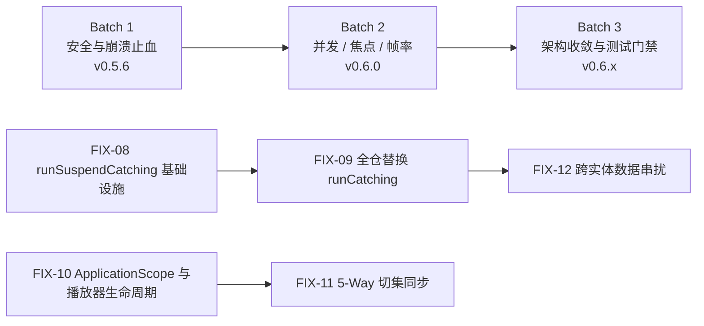

# BTV 审计问题修复计划

> 配套文档：[全量架构与代码质量审计报告](全量架构与代码质量审计报告.md) | [AGENTS.md](../AGENTS.md) | [开发计划](开发计划.md) | [真机测试与验收指南](真机测试与验收指南.md)
> 基线版本：`v0.5.5`（提交 `4c44a2c`）
> 本文档将审计报告中的 **12 项 🔴 严重问题（C-01 ~ C-12）**、**13 项 🟡 重要建议（Y-01 ~ Y-13）**、**6 项 🔵 轻微优化（M-01 ~ M-06）** 拆解为可执行的修复任务，按批次推进，每个任务都写明涉及文件、修复步骤、回归测试和验收标准。

---

## 一、总体策略

### 1.1 修复原则

1. **先止血，后重构**：先修安全漏洞、低版本崩溃和资源泄漏（会伤到用户数据或让应用崩溃的问题），再修并发与焦点问题，最后做架构收敛。
2. **先写失败测试，再改代码**：每个缺陷先补一个能复现问题的单测或插桩测试（修复前失败、修复后通过），防止回归。尤其是审计中发现的「把 Bug 写成正确断言」的测试（如 `TimestampTest`）必须先改正断言。
3. **一个任务一个 PR**：每个 `FIX-xx` 任务独立成 PR，PR 描述里写明对应审计编号（例如 `fix(security): FIX-01 清理登录凭证日志 [C-01]`），方便回溯。
4. **不顺手重构**：修 Bug 的 PR 只改与问题相关的代码。架构调整（如抽离 `SettingsViewModel`）放到第三批单独做，避免一次改动面过大难以审查和回滚。
5. **遵守 `AGENTS.md` 版本锁定**：修复过程中不升级 Kotlin / KSP / AGP / 依赖版本；如修复确实需要新依赖，须在 PR 中单独说明理由。

### 1.2 批次与版本规划

| 批次 | 主题 | 覆盖问题 | 目标版本 | 发布形式 |
|---|---|---|---|---|
| **Batch 1** | 安全、崩溃与泄漏止血 | C-01 ~ C-06、C-12 | `v0.5.6` | 热修复版，修完即发 |
| **Batch 2** | 并发正确性、TV 焦点与帧率 | C-07 ~ C-11、Y-04 ~ Y-09 | `v0.6.0` | 常规版本 |
| **Batch 3** | 架构收敛、设计规范与测试门禁 | Y-01 ~ Y-03、Y-10 ~ Y-13、M-01 ~ M-06 | `v0.6.1` ~ `v0.6.x` | 可分多次小版本发布 |



### 1.3 每个 PR 的通用验收门禁

Windows 环境需先把 `JAVA_HOME` 指向 JDK 17+（系统默认的 JDK 8 无法运行 Gradle）：

```bash
./gradlew ktlintCheck detekt
./gradlew test
./gradlew :app:testDebugUnitTest
./gradlew assembleDebug
# 涉及 UI / DAO / 播放器的 PR 额外执行（需连接设备或模拟器）
./gradlew :app:connectedDebugAndroidTest
```

- 新增或修改的代码必须带 KDoc（`AGENTS.md` §3.1）。
- 新增测试一律使用代码块体 `@Test fun xxx() { runTest { ... } }`，禁止 `= runTest`（`AGENTS.md` §11.9.2）。
- 涉及播放器、焦点、触屏的 PR，按[真机测试与验收指南](真机测试与验收指南.md)在至少一台 Android TV 真机上走查。

---

## 二、Batch 1：安全、崩溃与泄漏止血（目标 `v0.5.6`）

### FIX-01 清理登录凭证泄露与网络安全配置 【C-01】

**涉及文件**：
- [`LoginRepository.kt`](../bili-api/src/main/kotlin/dev/frost819/newbv/biliapi/repositories/LoginRepository.kt#L104)
- [`BiliUserAgent.kt`](../bili-api/src/main/kotlin/dev/frost819/newbv/biliapi/http/plugins/BiliUserAgent.kt#L55)
- [`network_security_config.xml`](../app/src/main/res/xml/network_security_config.xml)
- [`AccountRepositoryImpl.kt`](../app/src/main/kotlin/dev/frost819/newbv/app/data/AccountRepositoryImpl.kt#L236-L260)
- [`AndroidManifest.xml`](../app/src/main/AndroidManifest.xml#L47-L49)、[`backup_rules.xml`](../app/src/main/res/xml/backup_rules.xml)、[`data_extraction_rules.xml`](../app/src/main/res/xml/data_extraction_rules.xml)
- [`CrashHandler.kt`](../core/src/main/kotlin/dev/frost819/newbv/core/log/CrashHandler.kt)、[`CrashUploader.kt`](../core/src/main/kotlin/dev/frost819/newbv/core/log/CrashUploader.kt)

**修复步骤**：
1. 删除 `LoginRepository.kt:104` 的 `println(response)`。
2. `BiliUserAgent.kt:55` 打印 URL 前先脱敏 `access_key` / `access_token` 参数。
3. 在 `:core` 新增 `LogSanitizer`，用正则把 `SESSDATA`、`bili_jct`、`access_key`、`access_token`、`refresh_token` 的值替换为 `***`；`CrashHandler` 写日志文件和 `CrashUploader` 上报前统一过一遍。
4. `network_security_config.xml` 按 `AGENTS.md` §11.1.4 改写：`base-config` 关闭明文、只信任 `system` 证书；仅对 `bilivideo.com`、`bilivideo.cn`、`hdslb.com` 放行明文；`user` 证书移入 `<debug-overrides>`。
5. `AccountRepositoryImpl.logout()` 补充清空 `BiliHttpApi.sessData`、`biliJct`、`mid`、`accessToken`；`initFromPrefs()` 补同步 `incognitoMode`。
6. 在备份规则中显式 `<exclude>` DataStore 文件（`datastore/`）和 `AppDatabase` 数据库。

**回归测试**：
- `LogSanitizerTest`：覆盖 Cookie 串、URL query、JSON 三种格式的脱敏。
- `AccountRepositoryImplTest`：新增「`logout()` 后 `BiliHttpApi` 四个鉴权字段为空」「冷启动恢复 `incognitoMode`」用例。

**验收标准**：
- 全仓 `bili-api/src/main` 搜索不到打印登录响应的语句。
- 真机扫码登录后执行 `adb logcat | findstr SESSDATA` 无结果。
- 退出登录后打开首页，抓包确认请求不再带 `SESSDATA` Cookie。
- 视频、图片、直播流在新网络配置下均可正常加载（重点验证 `http://` 开头的 CDN 地址）。

> [!WARNING]
> 收紧明文流量后，若有未列入白名单的 B 站 CDN 域名使用 `http://`，会直接加载失败。上线前需在真机上把首页、播放、直播、头像、封面全部走一遍，必要时补充域名白名单。

---

### FIX-02 重构用户锁：旧密码校验、焦点、退格与保存时序 【C-02】

**涉及文件**：
- [`UserLockSettingsScreen.kt`](../app/src/main/kotlin/dev/frost819/newbv/app/ui/screen/user/lock/UserLockSettingsScreen.kt)
- [`UnlockUserScreen.kt`](../app/src/main/kotlin/dev/frost819/newbv/app/ui/screen/user/lock/UnlockUserScreen.kt)
- 新建 `app/src/main/kotlin/dev/frost819/newbv/app/viewmodel/user/UserLockViewModel.kt`

**修复步骤**：
1. 把 `UserLockViewModel` 移到 `viewmodel/user/`，注入 `AccountRepository` 接口（不再注入 `AccountRepositoryImpl`）。
2. ViewModel 暴露 `StateFlow<UserLockUiState>`：初始化时加载当前用户 `uid` 和已有 `lock`；已有锁时初始阶段为 `InputOldPassword`。
3. 旧密码校验、新密码两次确认的状态机全部移入 ViewModel，UI 只发事件（`onKey(direction)`、`onConfirm()`、`onBack()`）。
4. `saveLock` 等数据库写入完成后再通过 `Channel` 发出 `Saved` 事件，UI 收到后才调用 `onSaved()` 返回。
5. 两个页面的按键接收容器补 `.focusable()`（放在 `.focusRequester(...)` 之后）。
6. 退格逻辑 `drop(1)` 改为 `dropLast(1)`。
7. `BackHandler` 补齐所有阶段：输入为空时能正常退出页面，不再吞掉返回键。
8. UI 改为读取 ViewModel 状态，删除 `Prefs.uid` 直读。

**回归测试**：
- 新建 `UserLockViewModelTest`（目前覆盖率 0%）：
  - 已有锁 → 初始阶段为 `InputOldPassword`；
  - 旧密码错误 → 停留在旧密码阶段并提示；
  - 旧密码正确 → 进入新密码阶段；
  - 两次新密码不一致 → 回到新密码阶段；
  - 保存成功后才发出 `Saved` 事件；
  - 退格只删最后一位。
- 插桩测试 `UserLockSettingsScreenTest`：进入页面后方向键能被接收，返回键能退出。

**验收标准**：
- 已设锁账号进入设置页时，必须先输对旧密码才能修改或清除。
- 真机上进入页面后方向键输入有反馈，按返回键可正常退出。

---

### FIX-03 修复 `minSdk 21` 兼容性崩溃 【C-03】

**涉及文件**：
- [`CrashHandler.kt:241, 254`](../core/src/main/kotlin/dev/frost819/newbv/core/log/CrashHandler.kt#L238-L255)
- [`CrashUploader.kt:138`](../core/src/main/kotlin/dev/frost819/newbv/core/log/CrashUploader.kt#L138)

**修复步骤**：
1. `packageInfo.longVersionCode` 替换为 `PackageInfoCompat.getLongVersionCode(packageInfo)`。
2. `SimpleDateFormat("...XXX", Locale.getDefault())` 改为 `SimpleDateFormat("yyyy-MM-dd'T'HH:mm:ssZ", Locale.US)`，再把末尾 `+0800` 格式化为 `+08:00`；抽成一个可测试的工具函数。
3. 全仓扫一遍其他高版本 API 调用：启用 Android Lint 的 `NewApi` 检查，把结果作为本任务附带清单逐项确认。

**回归测试**：
- `CrashUploaderTest`：时间格式工具函数输出符合 ISO-8601（`yyyy-MM-ddTHH:mm:ss+08:00`）。
- 插桩测试在 API 21 / 23 模拟器上执行 `CrashHandler` 手动导出日志用例。

**验收标准**：
- `./gradlew :app:lintDebug` 无 `NewApi` 错误。
- API 21 模拟器上手动导出日志、触发测试崩溃均能正常写出日志文件。

---

### FIX-04 消除直播双 `ExoPlayer` 泄漏并补全释放逻辑 【C-04】

**涉及文件**：
- [`ExoMediaPlayer.kt`](../player/src/main/kotlin/dev/frost819/newbv/player/impl/exo/ExoMediaPlayer.kt)
- [`OkHttpUtil.kt`](../player/src/main/kotlin/dev/frost819/newbv/player/OkHttpUtil.kt#L49-L50)
- [`LivePlayerViewModel.kt`](../app/src/main/kotlin/dev/frost819/newbv/app/viewmodel/live/LivePlayerViewModel.kt#L131-L181)
- [`PlayerViewModel.kt:461`](../app/src/main/kotlin/dev/frost819/newbv/app/viewmodel/player/PlayerViewModel.kt#L461-L485)

**修复步骤**：
1. `ExoMediaPlayer` 构造时把 `context` 转为 `applicationContext` 保存。
2. `initPlayer()` 开头先 `removeListener(this)` + `release()` 旧实例，保证重复调用不泄漏。
3. `release()` 补齐 `removeListener`，并把 `mPlayer`、`mMediaSource`、`mPlayerEventListener` 置空。
4. 实现 `reset()`：`stop()` + `clearMediaItems()` + 清空 `mMediaSource`，去掉 `TODO()`。
5. `LivePlayerViewModel.initVideoPlayer` 删除多余的 `videoPlayer?.initPlayer()`，开头先释放旧 `videoPlayer`，传入 `context.applicationContext`。
6. `PlayerViewModel.initVideoPlayer` 开头同样先释放旧实例。
7. `OkHttpUtil` 读取证书时使用 `.use {}` 关闭流；自定义 SSL 的 `OkHttpClient` 改为单例复用，不再每个播放器实例新建一个连接池。

**回归测试**：
- `ExoMediaPlayerTest`：连续调用两次 `initPlayer()` 只保留一个播放器实例；`release()` 后监听器已解绑。
- `LivePlayerViewModelTest`：`initVideoPlayer` 调用两次时旧实例被释放。

**验收标准**：
- 真机反复进出直播间 10 次，Android Studio Profiler 中 `ExoPlayer` 播放线程数不增长，LeakCanary（如接入）无 `MainActivity` 泄漏报告。

---

### FIX-05 修复直播 `BEHIND_LIVE_WINDOW` 死锁与解码失败吞错 【C-05】

**涉及文件**：
- [`ExoMediaPlayer.kt:311-353`](../player/src/main/kotlin/dev/frost819/newbv/player/impl/exo/ExoMediaPlayer.kt#L311-L353)
- [`VideoPlayerListener.kt`](../player/src/main/kotlin/dev/frost819/newbv/player/VideoPlayerListener.kt#L18)
- [`LivePlayerViewModel.kt`](../app/src/main/kotlin/dev/frost819/newbv/app/viewmodel/live/LivePlayerViewModel.kt#L139-L177)

**修复步骤**：
1. 防抖窗口内再次出错时，不再直接 `return`：用主线程 `Handler.postDelayed` 在剩余间隔后补做恢复；超过最大恢复次数则回调 `onError`。
2. `release()` 时移除待执行的恢复任务。
3. `onVideoDecodeUnsupported` 的默认实现改为转发给 `onError`（或增加 `error` 参数），避免监听方没重写时错误被吞掉。
4. `LivePlayerViewModel` 实现该回调：先尝试降级画质 / 切线路，失败后切到错误态。

**回归测试**：
- `ExoMediaPlayerTest`：模拟 1.2 秒内连续两次 `BEHIND_LIVE_WINDOW`，第二次会在延迟后重新 `prepare()`；超过次数后 `onError` 被调用。
- `LivePlayerViewModelTest`：解码不支持时 UI 状态变为降级或错误态，不会一直停在缓冲。

**验收标准**：
- 真机直播弱网（限速）测试 30 分钟，出现落后直播窗口时能自动恢复或显示错误提示，不会画面定格且无提示。

---

### FIX-06 修复 `Prefs` 全局 `StateFlow` 协程泄漏 【C-06】

**涉及文件**：
- [`Prefs.kt:433-458`](../data/src/main/kotlin/dev/frost819/newbv/data/datastore/Prefs.kt#L433-L458)
- [`MainActivity.kt:50-59`](../app/src/main/kotlin/dev/frost819/newbv/app/MainActivity.kt#L50-L59)

**修复步骤**：
1. `themeModeFlow`、`homeHeroModeFlow`、`densityFlow` 从 `get()` 改为 `by lazy`，只创建一次。
2. `stateIn` 的初始值改为当前内存中的实际值（`themeMode` / `homeHeroMode` / `density`），避免首帧闪烁。
3. 修正 `?: 0` 兜底值与初始值不一致的问题。
4. `MainActivity` 改为 `collectAsStateWithLifecycle()`，去掉类型不匹配的 `initial = ThemeMode.Dark`，`else` 分支随之删除。

**回归测试**：
- `PrefsTest`：多次访问 `themeModeFlow` 返回同一个实例；修改 `themeMode` 后 Flow 能收到新值。

**验收标准**：
- 设置为浅色主题后冷启动，首帧不再闪深色。

---

### FIX-07 修复高危空断言、雪碧图崩溃与字幕时间轴 【C-12】

**涉及文件**：
- `!!` 高危点：[`HistoryRepository.kt:45`](../bili-api/src/main/kotlin/dev/frost819/newbv/biliapi/repositories/HistoryRepository.kt#L45)、[`SeasonRepository.kt:39`](../bili-api/src/main/kotlin/dev/frost819/newbv/biliapi/repositories/SeasonRepository.kt#L39)、[`UserRepository.kt:181, 203`](../bili-api/src/main/kotlin/dev/frost819/newbv/biliapi/repositories/UserRepository.kt#L181)、[`BiliHttpApi.kt:204, 1817, 1989`](../bili-api/src/main/kotlin/dev/frost819/newbv/biliapi/http/BiliHttpApi.kt#L204)、[`VideoCodec.kt:40`](../player/src/main/kotlin/dev/frost819/newbv/player/entity/VideoCodec.kt#L40)、[`ExoMediaPlayer.kt:298`](../player/src/main/kotlin/dev/frost819/newbv/player/impl/exo/ExoMediaPlayer.kt#L296-L298)，以及 UI 层 `VideoDetailScreen.kt:171`、`PgcFeatureScreen.kt:155`、`LogViewerScreen.kt:216`、`NetworkDiagnosticsDialog.kt:145`
- 雪碧图：[`VideoShotExtends.kt`](../app/src/main/kotlin/dev/frost819/newbv/app/util/VideoShotExtends.kt)
- 字幕：[`Timestamp.kt`](../bili-subtitle/src/main/kotlin/dev/frost819/newbv/bilisubtitle/entity/Timestamp.kt#L37-L46)、[`SubtitleParser.kt`](../bili-subtitle/src/main/kotlin/dev/frost819/newbv/bilisubtitle/SubtitleParser.kt)

**修复步骤**：
1. Repository 鉴权参数的 `!!` 改为 `requireNotNull(...) { "登录凭证缺失" }` 或抛出业务异常，让上层能提示「请先登录」而不是崩溃。
2. `VideoCodec.fromCodecId` 改为 `entries.find { it.codecId != 0 && it.codecId == codecId } ?: AVC`。
3. UI 层 `!!` 改为 `?.let { ... }`。
4. `VideoShotExtends`：
   - 入口校验 `times`、`images` 非空且 `imageCountX`、`imageCountY` 大于 0；
   - `images[index]!!` 改为 `getOrNull`；
   - `time.toUShort()` 改用不会溢出的类型；
   - 每次解码新建 `BitmapFactory.Options`；
   - `decodeByteArray` 返回 `null` 时不写入缓存；
   - 去重任务改用缓存类自己持有的 `CoroutineScope`，避免一个调用方取消连带取消其他调用方。
5. `Timestamp.getSrtTime()` 改为 `String.format(Locale.US, "%02d:%02d:%02d,%03d", ...)`。
6. `SubtitleParser` 使用 `Json { ignoreUnknownKeys = true; coerceInputValues = true }`；SRT 按空行分块解析，支持多行字幕和空输入。

**回归测试**：
- 先修正 [`TimestampTest.kt:166-175`](../bili-subtitle/src/test/kotlin/dev/frost819/newbv/bilisubtitle/TimestampTest.kt#L166-L175) 的错误断言（`5ms` 应为 `00:00:00,005`）。
- `SubtitleParserTest`：空字符串、多行 SRT、带未知字段的 BCC JSON。
- `VideoCodecTest`：`fromCodecId(0)` 和未知值返回 `AVC`。
- 新建 `VideoShotExtendsTest`：空列表、宫格数为 0、解码失败返回 `null`、超过 18 小时的时间点。
- Repository 测试：未登录时调用需鉴权方法抛出业务异常而非 NPE。

**验收标准**：
- `src/main` 中高危 `!!` 清零（`grep "!!"` 结果仅剩已评估为安全的少数位置，并在 PR 中列出）。

---

### Batch 1 发布检查清单

- [ ] FIX-01 ~ FIX-07 全部合并，CI 门禁通过
- [ ] API 21 模拟器 + 至少一台 Android TV 真机冒烟测试通过
- [ ] 扫码登录 → 播放 → 直播 → 退出登录全流程无凭证日志、无崩溃
- [ ] 更新 `CHANGELOG` / 内置更新日志，版本号升至 `0.5.6`

---

## 三、Batch 2：并发正确性、TV 焦点与帧率（目标 `v0.6.0`）

### FIX-08 建立协程安全的异常处理基础设施 【C-07】

**涉及文件**：
- 新建 `bili-api/src/main/kotlin/dev/frost819/newbv/biliapi/util/SuspendCatching.kt`
- [`StatusExtends.kt`](../bili-api/src/main/kotlin/dev/frost819/newbv/biliapi/grpc/utils/StatusExtends.kt#L126-L153)

**修复步骤**：
1. 新增 `runSuspendCatching`：遇到外部取消（`CancellationException` 且不是 `TimeoutCancellationException`）直接重新抛出，其余异常包装为 `Result.failure`。
2. `handleGrpcException` 第一行加 `if (error is CancellationException) throw error`。
3. `Status.getTypeClass()` / `getDetail()` 对空 `detailsList` 做保护，避免 `first()` 抛异常。
4. 增加 detekt 自定义规则或 PR 检查清单：`suspend` 函数中禁止直接使用 `runCatching`。

**回归测试**：
- `SuspendCatchingTest`：外部取消被重新抛出；超时被包装为失败；普通异常被包装为失败。
- `GrpcInfrastructureTest`：`handleGrpcException(CancellationException())` 原样抛出；空 `detailsList` 不崩溃。

---

### FIX-09 全仓替换吞取消异常的 `runCatching` 【C-07】

**依赖**：FIX-08

**涉及文件**（按模块分 PR）：
- `:bili-api`：`VideoDetailRepository`、`VideoPlayRepository`、`LiveRepository`、`UserRepository`、`SearchRepository`、`RecommendVideoRepository`、`BiliHttpApi`、`LiveDataWebSocket`
- `:app` 数据层：`AccountRepositoryImpl`、`VideoInfoRepository`
- `:app` ViewModel：`VideoDetailViewModel`、`LoginViewModel`、`SeasonDetailViewModel`、`SearchInputViewModel`、`SubtitleViewModel`、`PlayerViewModel.updateVideoShot`、`PersonalViewModel.loadFavoriteItems`

**修复步骤**：
1. 挂起调用处的 `runCatching` 全部替换为 `runSuspendCatching`。
2. `LiveRepository` 双层降级请求：主请求被取消时不再发起备用请求。
3. `LoginViewModel` 扫码轮询：
   - `while (true)` 改为 `while (isActive && attempts < MAX_POLL_ATTEMPTS)`；
   - 成功 / 过期分支 `break`；
   - 二维码请求协程保存为 `qrRequestJob`，重新请求或重置时先取消。
4. `VideoDetailViewModel` 中嵌套在 `withTimeout` 内的 `fetchFavoriteFolders` / `fetchFollowingStatus` 不再吞掉超时。

**回归测试**：
- 每个被修改的 Repository / ViewModel 至少补一个「协程被取消时不进入错误态、不发起后续请求」的用例。
- `LoginViewModelTest`：调用 `cancelPolling()` 后状态不会变成 `Error`；达到最大轮询次数后停止；`advanceUntilIdle()` 不会死循环。

**验收标准**：
- `src/main` 中 `suspend` 上下文内的 `runCatching` 清零（PR 中附搜索结果）。

---

### FIX-10 新增应用级协程作用域并修复播放器生命周期 【C-08】

**涉及文件**：
- [`CoroutinesModule.kt`](../app/src/main/kotlin/dev/frost819/newbv/app/di/CoroutinesModule.kt)（新增 `@ApplicationScope`）
- [`PlayerViewModel.kt`](../app/src/main/kotlin/dev/frost819/newbv/app/viewmodel/player/PlayerViewModel.kt#L488-L497)
- [`PlayerScreens.kt`](../app/src/main/kotlin/dev/frost819/newbv/app/ui/screen/player/PlayerScreens.kt#L46-L90)
- [`BVApplication.kt`](../app/src/main/kotlin/dev/frost819/newbv/app/BVApplication.kt)（顺带收敛 4 个孤立 `CoroutineScope`）

**修复步骤**：
1. `CoroutinesModule` 提供 `@ApplicationScope CoroutineScope`（`SupervisorJob() + ioDispatcher`），`BVApplication` 中的 4 个孤立作用域统一改用它。
2. 退出播放器的末次进度上报改在 `@ApplicationScope` 中执行，外层套 `withTimeout(3_000L)`；删除 `detachedWorkScope` 及 `onCleared()` 中的 `cancel()`。
3. 切集上报上一集进度时，不再与周期心跳共用同一个 `heartbeatJob`，避免互相取消。
4. `onCleared()` 兜底释放 `videoPlayer`。
5. 播放器页面离开组合但未出栈时（前往详情页 / UP 主空间）：只暂停播放并同步进度，不销毁播放器；真正出栈（`onCleared`）时才释放。
6. `PlayerViewModel` 增加会话已初始化标记：页面重新进入组合时如会话已存在，按当前状态（而非初始路由参数）恢复，不再重置到第一集。

**回归测试**：
- `PlayerViewModelTest`：
  - `detachPlayer()` 后立即触发 `onCleared()`，末次心跳仍被调用；
  - 会话已初始化时再次 `init` 不会覆盖当前 `aid` / `cid` / 进度；
  - 快速连续切集时上一集的进度上报不会被取消。

**验收标准**：
- 真机播放到第 2 集某个位置 → 打开 UP 主空间 → 返回，仍停留在第 2 集原位置。
- 播放后直接按返回退出，B 站网页端历史记录能看到准确进度。

---

### FIX-11 修复播放器 5-Way 切集状态同步 【Y-04】

**依赖**：FIX-10

**涉及文件**：
- [`VideoPlayerScreen.kt:148-162, 346-352`](../app/src/main/kotlin/dev/frost819/newbv/app/ui/screen/player/VideoPlayerScreen.kt#L148-L162)
- [`VideoListViewModel.kt`](../app/src/main/kotlin/dev/frost819/newbv/app/viewmodel/player/VideoListViewModel.kt#L33-L61)
- [`PlayerViewModel.kt:745-821, 915-932`](../app/src/main/kotlin/dev/frost819/newbv/app/viewmodel/player/PlayerViewModel.kt#L745-L821)
- [`DanmakuViewModel.kt`](../app/src/main/kotlin/dev/frost819/newbv/app/viewmodel/player/DanmakuViewModel.kt#L145-L239)
- [`SubtitleViewModel.kt`](../app/src/main/kotlin/dev/frost819/newbv/app/viewmodel/player/SubtitleViewModel.kt)

**修复步骤**：
1. `VideoListViewModel.currentAid` 改为 `MutableStateFlow`，用 `combine` 过滤相关推荐；`videoSwitchEvent` 收集处调用 `setCurrentAid(event.aid)`。
2. `playNewVideo`：
   - `cid == 0` 或需要更新详情时，先拿到详情补齐 `cid`、`authorMid`、`authorName`、历史进度，再发出切换事件和加载播放地址；
   - 历史进度跳转只在首次起播时生效（一次性标记），避免之后暂停恢复时跳回历史位置；
   - 统一取消播放相关的倒计时任务（抽成 `cancelPlaybackScopedJobs()`，`detachPlayer` 也调用）。
3. `retryPlayback` 只保留一处恢复定位，不再弹「回到开头」提示。
4. `DanmakuViewModel.loadDanmaku` 入口同步取消旧的分段监听任务；写入引擎前校验加载代次；`init()` 先释放旧 `DanmakuPlayer`；补 `onCleared()`。
5. `SubtitleViewModel` 的加载任务保存 `Job`，切集或清除时取消，并加 `withTimeout`。

**回归测试**：
- `VideoListViewModelTest`：切换 `aid` 后能收到新视频的相关推荐。
- `PlayerViewModelTest`：切到 `cid = 0` 的相关推荐视频时，详情返回前不请求播放地址；切换后 `authorMid` 正确；暂停恢复不再跳回历史位置。
- `DanmakuViewModelTest`：切集期间旧分段数据不会写入弹幕引擎。
- `SubtitleViewModelTest`：补 `loadSubtitleList` / `selectSubtitle` 成功、失败、切集并发用例。

---

### FIX-12 修复跨实体数据串扰与竞态 【C-09】

**依赖**：FIX-09

**涉及文件**与对应修复：

| 文件 | 修复内容 |
|---|---|
| [`VideoDetailViewModel.kt:134-135`](../app/src/main/kotlin/dev/frost819/newbv/app/viewmodel/detail/VideoDetailViewModel.kt#L126-L138) | `state?.lastPlayedCid/Time` 改为 `matched?.`；`updateFavorite` 共享状态更新移到成功回调；点赞 / 投币 / 收藏 / 三连加防重入 |
| [`UserSpaceViewModel.kt`](../app/src/main/kotlin/dev/frost819/newbv/app/viewmodel/user/UserSpaceViewModel.kt#L75-L135) | 新增 `loadJob`；`mid` 变化或刷新时取消旧任务并重置 `videos`、`videoPage`、`loading`、`hasMore`；写回前校验 `mid` |
| [`UserSwitchViewModel.kt`](../app/src/main/kotlin/dev/frost819/newbv/app/viewmodel/user/UserSwitchViewModel.kt#L84-L95) | 只有删除的是当前账号时才切换或登出 |
| [`PersonalViewModel.kt`](../app/src/main/kotlin/dev/frost819/newbv/app/viewmodel/personal/PersonalViewModel.kt) | 稍后再看、历史、收藏夹、追番各自维护 `Job`；刷新 / 切筛选时取消并重置加载标记；`loadFavoriteFolders` 不提前清除加载态；监听账号切换 |
| [`PgcViewModel.kt`](../app/src/main/kotlin/dev/frost819/newbv/app/viewmodel/pgc/PgcViewModel.kt)、[`UgcViewModel.kt`](../app/src/main/kotlin/dev/frost819/newbv/app/viewmodel/ugc/UgcViewModel.kt) | 保存并取消 `loadJob` / `carouselJob`；写回前校验分区类型 |
| [`HomeViewModel.kt`](../app/src/main/kotlin/dev/frost819/newbv/app/viewmodel/home/HomeViewModel.kt#L132-L150) | 冷启动同步初始化 `currentUid`；`finally` 只在当前任务仍有效时清除加载态；登出时取消动态请求 |
| [`SearchResultViewModel.kt`](../app/src/main/kotlin/dev/frost819/newbv/app/viewmodel/search/SearchResultViewModel.kt)、[`SeasonDetailViewModel.kt`](../app/src/main/kotlin/dev/frost819/newbv/app/viewmodel/pgc/SeasonDetailViewModel.kt)、[`CommentViewModel.kt`](../app/src/main/kotlin/dev/frost819/newbv/app/viewmodel/comment/CommentViewModel.kt) | 写回前校验关键词 / 季度 / `aid`；重试使用当前季度；`cancelAll()` 取消点赞任务 |
| [`LogViewerViewModel.kt`](../app/src/main/kotlin/dev/frost819/newbv/app/viewmodel/settings/LogViewerViewModel.kt) | 注入 `@IoDispatcher`；全部改用 `_uiState.update`；`httpServer.start()` 加异常保护；改继承 `ViewModel()` |
| [`MediaCodecScreen.kt:72-79`](../app/src/main/kotlin/dev/frost819/newbv/app/ui/screen/settings/MediaCodecScreen.kt#L72-L79) | 后台线程只计算结果，回到主线程一次性赋值不可变列表（后续在 FIX-20 迁入 ViewModel） |

**回归测试**（补齐审计中发现的漏测场景）：
- `UserSpaceViewModelTest`：`mid` 从 1 切到 2 后 `videos` 只包含 UP2 的视频（断言内容，不只断言调用次数）。
- `UserSwitchViewModelTest`：多账号时删除非当前账号，当前账号不变。
- `HomeViewModelTest`：已登录冷启动时推荐 / 热门 / 动态各只请求一次。
- `VideoDetailViewModelTest`：其他视频的共享状态更新不会改写本视频进度；收藏失败后状态回滚；连续两次投币只发一次请求。
- `PersonalViewModelTest`、`PgcViewModelTest`、`UgcViewModelTest`：加载中切换筛选 / 分区，最终数据只属于新筛选 / 新分区。
- `LogViewerViewModelTest`：去掉 `Thread.sleep`，改用 `StandardTestDispatcher` + `advanceUntilIdle()`；`onCleared` 测试真正触发 ViewModel 的 `onCleared()`。

---

### FIX-13 修复 `FocusSaver` 与 TV 焦点阻断问题 【C-10、Y-09】

**涉及文件**：
- [`FocusSaver.kt:77-105`](../app/src/main/kotlin/dev/frost819/newbv/app/ui/component/FocusSaver.kt#L77-L105)
- [`VideoDetailScreen.kt`](../app/src/main/kotlin/dev/frost819/newbv/app/ui/screen/detail/VideoDetailScreen.kt)（L490-492、L1018、L1145、L1195）
- [`PgcFeatureScreen.kt`](../app/src/main/kotlin/dev/frost819/newbv/app/ui/screen/pgc/PgcFeatureScreen.kt)（L514、L644）
- [`PersonalContent.kt:178-185`](../app/src/main/kotlin/dev/frost819/newbv/app/ui/screen/personal/PersonalContent.kt#L178-L185)、[`UgcContent.kt:124-131`](../app/src/main/kotlin/dev/frost819/newbv/app/ui/screen/ugc/UgcContent.kt#L124-L131)
- 播放器菜单：[`MenuController.kt`](../app/src/main/kotlin/dev/frost819/newbv/app/ui/component/player/menu/MenuController.kt)、[`AudioMenu.kt`](../app/src/main/kotlin/dev/frost819/newbv/app/ui/component/player/menu/AudioMenu.kt)、`RadioMenuList.kt`、`PlayerThreeLevelMenu.kt`、`StepLessMenuItem.kt`、`LiveMenuController.kt`

**修复步骤**：
1. **`FocusSaver.RestoreFocus`**：`LaunchedEffect(savedKey.value)` 改为 `LaunchedEffect(Unit)`；每次重试时重新查找 `requesters[key]`（代码见审计报告示例 1）。
2. **父级 `LazyRow` 覆盖子项 key**：删除父级 `onFocusChanged { saveFocusedKey(...) }`，只保留 `.focusRestorer(...)`；多个合集分区使用不同 key。
3. **收藏夹弹窗**：删除 `onGloballyPositioned` 抢焦，改为在 `Dialog` 内部 `LaunchedEffect(Unit)` 请求一次焦点。
4. **菜单键劫持**：仅在顶部导航栏有焦点时才拦截菜单键刷新，内容区放行给卡片和追番筛选弹窗。
5. **播放器设置菜单**：
   - `MenuController` 创建 `navFocusRequester` 传给各子菜单，按右键返回时显式请求焦点；
   - 根容器补 `.focusable()`，关闭菜单时把焦点还给控制器；
   - `RadioMenuList` 选中项不存在时默认绑定第一项；
   - `StepLessMenuItem` 上下箭头不再可聚焦，只保留中间项；
   - 最左列消费左方向键，防止焦点穿透到背景播放器。
6. **纯索引焦点 key**（17 处）：改为业务唯一 ID（`aid`、`seasonId`、`mid`、`roomId`、搜索词等），清单见审计报告 Y-09。
7. **弹窗初始焦点**：把写在 `Dialog` 外部的 `LaunchedEffect` 移入内部；给 `OptionDialog`、`FollowingSeasonFilterDialog`、`VideoInteractionDialog`、`NetworkDiagnosticsDialog`、`PlayerCustomShortcutsDialog` 各阶段、`StorageSetting` 弹窗补初始焦点；弹窗内的 `fillMaxWidth(...)` 改为固定宽度范围。
8. **首次进入页面无焦点**：`SearchScreen`、`FollowScreen`、`UserSpaceScreen`、`UserSwitchScreen` 补 `fallbackRequester`。
9. **直播错误态**：`LivePlayerController` 给 `PlayStateTips` 传入 `onRetry` / `onExit` / `onOpenDiagnostics`；菜单键补兼容 `Key(763)`。
10. **快捷微菜单**：`PlayerQuickMenuPopover` 打开期间暂停 OSD 自动隐藏；`LaunchedEffect` 的 key 加上 `items.size`。

**回归测试**（插桩测试）：
- `FocusSaverTest`：页面内移动焦点到不保存 key 的区域，60ms 后焦点不会被拉回；返回页面时 Lazy 子项晚挂载也能恢复焦点。
- `PersonalContentTest`：卡片获焦时按菜单键能打开操作弹窗。
- `MenuControllerTest`：在音轨列表按右键后，焦点落到右侧导航栏。
- `FavoriteFolderDialogTest`：勾选收藏夹后焦点保持在当前项。

**验收标准**（真机走查）：
- 首页 / 历史 / 详情页进入播放后返回，焦点回到原卡片。
- 个人中心、分区页卡片上按菜单键可以打开操作菜单。
- 播放器设置菜单所有子菜单都能用方向键进入和退出，焦点不会跑到背景。

---

### FIX-14 修复播放器重组热点与弹幕蒙版主线程解码 【C-11】

**涉及文件**：
- [`VideoPlayerController.kt:632-637`](../app/src/main/kotlin/dev/frost819/newbv/app/ui/component/player/VideoPlayerController.kt#L632-L637)
- [`ControllerVideoInfo.kt`](../app/src/main/kotlin/dev/frost819/newbv/app/ui/component/player/ControllerVideoInfo.kt)（L617、L686）
- [`BottomSubtitle.kt`](../app/src/main/kotlin/dev/frost819/newbv/app/ui/component/player/BottomSubtitle.kt#L57-L62)
- [`MaskModifiers.kt`](../danmaku/src/main/kotlin/dev/frost819/newbv/danmaku/util/MaskModifiers.kt)
- [`VideoPlayerScreen.kt:106-128`](../app/src/main/kotlin/dev/frost819/newbv/app/ui/screen/player/VideoPlayerScreen.kt#L106-L128)

**修复步骤**：
1. 进度状态改为以 `() -> SeekerState`（或 `State<SeekerState>`）向下传递，只在进度条、常显进度条、调试信息等叶子组件里读取。
2. 删除 `ControllerVideoInfo` 外层的 `Modifier.focusable()`（隐藏时会留下全屏可聚焦节点）和进度条内层多余的 `.focusable()`。
3. `BottomSubtitle` 去掉每 100ms 重启一次的 `LaunchedEffect`，改为 `remember(subtitleData, currentTime)` + 二分查找。
4. `MaskModifiers`：
   - 从 `Modifier.composed` 迁移到 `Modifier.Node` 或普通扩展；
   - SVG / 位图解码移到 `DanmakuViewModel` 或 `DanmakuMaskFinder` 中在 `Dispatchers.Default` 预先完成，UI 只接收已解码的 `ImageBitmap`；
   - `Paint` 对象缓存复用；
   - 尺寸为 0、宽高比非法、数据长度不足时直接绘制原内容。
5. 相关推荐的卡片数据映射单独 `remember(videoListState.relatedVideos)`。
6. 删除零引用的 `PlayerMenuViewModel` 及 `PlayerUiState` 中从未写入的冗余字段。

**回归测试**：
- Compose 插桩测试：OSD 隐藏时进度变化不会触发 `ControllerVideoInfo` 重组（用重组计数器断言）。
- `MaskModifiersTest` / `DanmakuMaskFinderTest`：尺寸为 0、数据越界时不抛异常。
- `BottomSubtitleTest`：二分查找命中正确字幕。

**验收标准**：
- 开启弹幕蒙版 + 字幕，在低端电视盒子上用 Layout Inspector 观察，OSD 隐藏时控制器重组次数接近 0；`adb shell dumpsys gfxinfo` 掉帧率较修复前明显下降（在 PR 中附前后对比数据）。

---

### FIX-15 修复触屏与手势兼容问题 【Y-08】

**涉及文件**：
- [`MainActivity.kt:74-77`](../app/src/main/kotlin/dev/frost819/newbv/app/MainActivity.kt#L74-L77)
- [`LeftNaviContent.kt:288`](../app/src/main/kotlin/dev/frost819/newbv/app/ui/screen/main/LeftNaviContent.kt#L288)、[`VideoCardActionDialog.kt:317`](../app/src/main/kotlin/dev/frost819/newbv/app/ui/component/videocard/VideoCardActionDialog.kt#L317)、`HomeShelfRow.kt:257`、`HomeShelvesContent.kt:209`、`PersonalContent.kt:240`、`LogViewerScreen.kt:147`、`PlayerErrorOverlay.kt:195`、`NetworkDiagnosticsDialog.kt`、`NextPlayOverlay.kt`
- [`CommentsDialog.kt:674`](../app/src/main/kotlin/dev/frost819/newbv/app/ui/component/comment/CommentsDialog.kt#L674)、`SettingsMenuSelectItem.kt:46`、`OtherSetting.kt:72-88`、`StorageSetting.kt:120-136`
- [`PlayerGestureHandler.kt`](../app/src/main/kotlin/dev/frost819/newbv/app/ui/component/player/PlayerGestureHandler.kt)
- [`VideoPlayerScreen.kt:219-240`](../app/src/main/kotlin/dev/frost819/newbv/app/ui/screen/player/VideoPlayerScreen.kt#L219-L240)

**修复步骤**：
1. `MainActivity` 改为重写 `dispatchTouchEvent`，在 `ACTION_DOWN` 时调用 `interactionTracker.onTouch()`。
2. 上述 TV 组件补 `.touchClickable(onClick = ...)`；禁用态按钮透传 `enabled`。
3. `RadioButton` 的 `onClick` 改为 `null`；设置页手写的开关项替换为 `SettingSwitchListItem`。
4. 手势音量改为累计浮点位移计算；`maxVolume <= 0` 时直接返回；回调用 `rememberUpdatedState` 包装。
5. 前后台切换：只有因切后台而暂停的视频，回到前台时才自动恢复播放。

**回归测试**：
- 插桩测试：触屏点击左侧导航项能切换页面；操作弹窗按钮触屏可点击；禁用的「上一页」按钮触屏无响应。
- `PlayerGestureHandlerTest`：连续小位移累计后能调整音量；`maxVolume = 0` 不崩溃。

---

### FIX-16 底层并发与资源安全加固 【Y-05、Y-06、Y-07】

**涉及文件与修复内容**：

| 文件 | 修复内容 |
|---|---|
| [`BiliHttpApi.kt`](../bili-api/src/main/kotlin/dev/frost819/newbv/biliapi/http/BiliHttpApi.kt) | `client` 改为 `by lazy`；共享鉴权字段加 `@Volatile`；`updateWbi()` 加 `Mutex`；重试只针对 GET / HEAD；`getDanmakuXml` 禁用 XML 外部实体 |
| `AuthRepository.kt`、`ChannelRepository.kt` | 可变字段加 `@Volatile`，通道初始化 / 关闭加锁 |
| [`Prefs.kt`](../data/src/main/kotlin/dev/frost819/newbv/data/datastore/Prefs.kt#L501-L547) | 写入作用域改为 `Dispatchers.IO.limitedParallelism(1)` 保证顺序；`clear()` 加 `persistMutex`；`flowOf` 返回只读 `StateFlow` |
| [`VideoCapability.kt`](../app/src/main/kotlin/dev/frost819/newbv/app/util/VideoCapability.kt#L64) | 缓存改为 `ConcurrentHashMap`（注意不要用 API 24+ 的 `computeIfAbsent`） |
| [`Zlib.kt`](../bili-api/src/main/kotlin/dev/frost819/newbv/biliapi/http/util/Zlib.kt) | `try/finally` 中调用 `end()`；循环缓冲写出；限制解压后大小 |
| [`LiveDataWebSocket.kt`](../bili-api/src/main/kotlin/dev/frost819/newbv/biliapi/websocket/LiveDataWebSocket.kt) | `seq` 改为 `AtomicInteger`；首包失败可重试或关闭 Flow；限制解包递归深度；去掉 `!!` |
| [`CrashHandler.kt`](../core/src/main/kotlin/dev/frost819/newbv/core/log/CrashHandler.kt#L83-L117) | `logcat` 加 `-d`；流用 `.use {}`，`finally` 中 `process.destroy()`；`listCrashLogs()` 只列 `.log`；文件名去掉冒号 |
| [`HttpServer.kt`](../app/src/main/kotlin/dev/frost819/newbv/app/network/HttpServer.kt) | `start()` / `stop()` 加同步；端口解析不在主线程阻塞；访问地址带随机 Token |
| [`VideoInfoRepository.kt:163-172`](../app/src/main/kotlin/dev/frost819/newbv/app/data/VideoInfoRepository.kt#L163-L172) | 网络请求移出 `update {}`，限制并发后一次性合并结果 |
| 5 个 ViewModel 的 `_uiEffect` | 改为带缓冲的 `MutableSharedFlow` 或 `Channel.BUFFERED` |
| [`PersonalContent.kt:82-90`](../app/src/main/kotlin/dev/frost819/newbv/app/ui/screen/personal/PersonalContent.kt#L82-L90) | 删除重复的 Effect 收集，统一用 `ToastUtils` |
| 7 个 ViewModel 硬编码的 `Dispatchers.*` | 改为构造注入 `@IoDispatcher` / `@MainDispatcher` |
| 18 处缺超时的写操作 | 补 `withTimeout(LOAD_TIMEOUT_MS)`，并同步调整取消异常判断 |

**回归测试**：
- `PrefsTest`：快速连续写同一个键 100 次，最终落盘值为最后一次写入。
- `ZlibTest`：空数组、大数据、损坏数据。
- 新建 `LiveDataWebSocketTest`（目前 0% 覆盖）：分包解析、心跳、首包失败处理、关闭时取消定时任务。
- `HttpServerTest`：无 Token 访问返回 403；`.json` 文件不出现在列表中。
- 新建 `VideoCapabilityTest`：多线程并发查询不抛异常。

---

### FIX-17 Room 唯一索引与事务 【Y-06】

> [!IMPORTANT]
> 本任务涉及数据库结构变更，必须提供 Room Migration，并在升级路径（`v0.5.x` → `v0.6.0`）上做真机覆盖安装测试，确保已有账号和搜索历史不丢失。

**涉及文件**：
- [`UserEntity.kt`](../data/src/main/kotlin/dev/frost819/newbv/data/db/entity/UserEntity.kt)、[`SearchHistoryEntity.kt`](../data/src/main/kotlin/dev/frost819/newbv/data/db/entity/SearchHistoryEntity.kt)
- `SearchHistoryRepositoryImpl.kt`、`AccountRepositoryImpl.kt`、对应 DAO 与 `AppDatabase`

**修复步骤**：
1. 为 `uid`、`keyword` 添加唯一索引；Migration 中先去重再建索引。
2. DAO 提供 `@Transaction` 原子 upsert，替换「先查后写」。
3. 实体属性改为 `val`，更新时用 `copy()`。

**回归测试**：
- DAO 插桩测试：重复插入同一 `uid` / `keyword` 只保留一条。
- `MigrationTest`：从旧版本数据库（含重复数据）迁移成功且数据完整。

---

### Batch 2 发布检查清单

- [ ] FIX-08 ~ FIX-17 全部合并，CI 门禁通过
- [ ] 按[真机测试与验收指南](真机测试与验收指南.md)完成全量焦点走查（首页、详情、播放器、直播、个人中心、设置）
- [ ] 弱网直播 30 分钟稳定性测试通过
- [ ] 从 `v0.5.6` 覆盖安装升级，数据库迁移成功
- [ ] 版本号升至 `0.6.0`，更新日志写明主要修复项

---

## 四、Batch 3：架构收敛、设计规范与测试门禁（目标 `v0.6.x`）

### FIX-18 抽离 `UpdateViewModel` 并清理 OTA 依赖 【Y-01、Y-02】

**涉及文件**：[`UpdateDialog.kt`](../app/src/main/kotlin/dev/frost819/newbv/app/ui/component/settings/UpdateDialog.kt)、[`AboutSetting.kt`](../app/src/main/kotlin/dev/frost819/newbv/app/ui/screen/settings/content/AboutSetting.kt)、[`GithubApi.kt`](../app/src/main/kotlin/dev/frost819/newbv/app/network/GithubApi.kt)、[`GithubRelease.kt`](../app/src/main/kotlin/dev/frost819/newbv/app/network/entity/GithubRelease.kt)、[`OtaUpdateInstaller.kt`](../app/src/main/kotlin/dev/frost819/newbv/app/util/OtaUpdateInstaller.kt)

**修复步骤**：
1. 新建 `UpdateRepository`（封装版本检查、下载、文件校验）和 `UpdateViewModel`（`StateFlow<UpdateUiState>`），`UpdateDialog` 只负责展示。
2. `GithubApi`、`OtaUpdateInstaller` 改为 Hilt `@Singleton` 注入，复用统一 `HttpClient` 并配置超时。
3. **第三方代理 `ghfast.top` 的处理需要先和维护者确认**（见第六节待决策事项）：方案 A 直接移除；方案 B 默认走 GitHub 官方地址，失败后再回退镜像并校验 SHA-256。
4. `GithubRelease.body` 加默认值 `""`，`Asset.size` 改为 `Long`。
5. 安装会话写入失败时调用 `session.abandon()`。
6. `AboutSetting` 的版本检查改用 `UpdateViewModel`。

**回归测试**：`UpdateViewModelTest`（检查成功 / 无更新 / 网络失败 / 下载进度 / 校验失败）、`GithubApiTest`（用 Ktor `MockEngine`，覆盖 `body: null`）。

---

### FIX-19 抽离 `SettingsViewModel`，UI 不再直接读写 `Prefs` 【Y-01】

**涉及文件**：`AudioVideoSetting.kt`、`UISetting.kt`、`StorageSetting.kt`、`OtherSetting.kt`、`InfoSetting.kt`、`PlayerCustomShortcutsDialog.kt`、`SearchInputContent.kt`、`VideoNavigation.kt`、`MainScreen.kt`、`HomeContent.kt`、`HomeShelvesContent.kt`、`PersonalContent.kt`、`VideoPlayerController.kt`、`LivePlayerController.kt`、`VideoPlayerScreen.kt`、`LivePlayerScreen.kt`

**修复步骤**：
1. 新建 `SettingsRepository`（封装 `Prefs` 与 `PlayerCustomShortcutsStore`）和 `SettingsViewModel`，设置页通过 `StateFlow` 读取、通过事件写入。
2. 播放器相关偏好（常显进度条、调试信息、屏保时长、预解析好的快捷键映射）纳入 `PlayerViewModel` / `LivePlayerViewModel` 的 `UiState`，不再每次按键解析 JSON。
3. 首页、个人中心、主界面的初始 Tab 等配置由各自 ViewModel 提供。
4. 9 个 ViewModel 中直读的 `Prefs.apiType` / `isLogin` / `uid` 改为通过 Repository 接口获取，方便单测隔离。
5. 缓存统计与清理、内存 / 存储信息采集移入 ViewModel 异步执行。

**回归测试**：`SettingsViewModelTest`、`StorageSettingsViewModelTest`；各 ViewModel 测试不再依赖全局 `Prefs` 初始化。

---

### FIX-20 包结构与 DI 收敛 【Y-02、Y-03】

**修复步骤**：
1. `LiveAreaListViewModel`、`LiveFollowViewModel` 移到 `viewmodel/live/`；`CollectWatchLaterEffects` 移到 `ui/component/`。
2. `NetworkModule` 中 `AccountRepository` 改为 `@Binds` 绑定，所有 ViewModel 改注入接口；需要的方法（`uiState`、`addUser`、`refreshUserInfo`、`toggleIncognitoMode`）提升到接口。
3. `LivePlayerViewModel` 通过 `LiveRepository` 访问直播 WebSocket 和历史弹幕。
4. `PersonalViewModel.toViewItems` 合入 `PersonalUiState`；`UserSwitchUiState` 改用不含凭证的 UI 模型。
5. `BiliLiveHttpApi`、`BiliPassportHttpApi` 的 `lateinit var client` 改为 `by lazy` 并配置超时；评估各模块 HTTP 客户端合并方案。
6. `MediaCodecScreen` 迁入 `MediaCodecViewModel`。
7. `BVTheme.SystemBarsEffect` 用安全的 `findActivity()` 代替强转。

---

### FIX-21 Compose 规范与性能收尾 【Y-10】

**修复步骤**：
1. 全仓 37 处 `collectAsState()` 替换为 `collectAsStateWithLifecycle()`；删除 `PgcContent.kt:91`、`UgcContent.kt:98` 未使用的变量。
2. `FocusExt.focusedBorder` 只在需要动画且获焦时创建无限动画。
3. 高频滚动状态改用 `derivedStateOf`（`SearchInputContent`、`UpdateDialog`）。
4. 12 处 `Lazy` 列表补业务 `key`，6 处纯索引 `key` 改为业务 ID（分页去重放到 ViewModel）。
5. `OptionDialog` 参数改为 `List<T>`，调用处直接传 `Enum.entries`；去掉重组中的 `.toList()` / `.toTypedArray()`。
6. `TvLazyVerticalGrid` 同步 `TvLazyColumn` 的滚动死区逻辑。
7. `UnlockUserScreen` 删除 `LaunchedEffect` 内嵌套的 `scope.launch`。

---

### FIX-22 主题、对比度与圆角规范 【Y-11、M-05】

**修复步骤**：
1. 设置、编解码、日志页面的移动端 `Scaffold` / `AlertDialog` 替换为 TV Material3 组件。
2. 修复对比度问题：`SeasonCard` 评分文字指定白色；`EpisodeListDialog` Tab 文字交给 `LocalContentColor`；快捷菜单箭头和徽标在获焦时反色；文字透明度不低于 0.6。
3. 按 `AGENTS.md` §6.6.7 统一圆角：按钮使用 `BVShape.medium`，浮层使用 `BVShape.large`，删除硬编码 `RoundedCornerShape`；`UserSelectCard` 改用 `Surface`。
4. 删除 `ListItem` / `Surface` 外层的 `.clip(...)`，改用组件自带的 `shape` 参数。
5. 封面比例统一为 `16f / 9f`；直播卡片遮罩按规范加深。

**验收**：深色、浅色两种主题下截图对比，所有文字可读、获焦状态清晰。

---

### FIX-23 补齐零覆盖单测与测试规范整改 【Y-12、Y-13】

**修复步骤**：
1. 新建单测：`LiveHomeViewModelTest`、`LiveAreaListViewModelTest`、`LiveFollowViewModelTest`、`AuthRepositoryTest`、`ChannelRepositoryTest`、`CodecUtilTest`、`LiveRoomCardDataTest`（`formatOnlineCount`）。（`UserLockViewModelTest`、`LiveDataWebSocketTest`、`VideoShotExtendsTest`、`VideoCapabilityTest`、`GithubApiTest` 已在前面任务中完成。）
2. 批量把 23 个测试文件中的 `= runTest` 改为代码块体（纯格式调整，单独一个 PR，方便审查）。
3. `LoginViewModelTest`、`UserSwitchViewModelTest` 的 Main 调度器改为 `StandardTestDispatcher`；删除重复的假 `onCleared` 测试。
4. 测试中使用全局 `Prefs` 的类，在 `@BeforeEach` 中初始化独立实例并清理。
5. 补漏测用例：`WatchLaterViewModel.delToView`、`VideoInfoRepository.getOnlineWatchingText` / `updateVideoActionState`。
6. `VideoCodecTest` 改用 Truth 断言；`DanmakuMaskFinderTest` 去掉 `!!`。
7. 补插桩测试：`PlayerQuickMenuPopover`、`PlayerErrorOverlay`、`RelatedVideosController`、`MenuController` 三级联动。
8. 接入 JaCoCo 覆盖率报告，在 CI 中输出各模块覆盖率（低于 `AGENTS.md` §5.5.2 目标时标记警告）。

**验收标准**：`./gradlew test jacocoAggregatedReport` 通过；`:app` ViewModel 覆盖率 ≥ 80%、`:bili-api` ≥ 90%、`:bili-subtitle` ≥ 90%。

---

### FIX-24 文档、日志与构建配置收尾 【M-01 ~ M-04、M-06】

**修复步骤**：
1. 补 KDoc：`:bili-subtitle` 全模块、`:bili-api/repositories` 17 个仓库、各 ViewModel 公开属性、`core` / `data` 公开常量和枚举。
2. 删除注释掉的废弃代码（`SearchRepository.kt:35-66`、`StatusExtends.kt:16-27`、`ToViewRepository.kt:27`）；修正 `UgcViewModel`、`Logger`、`Prefs`、`BuvidGenerator`、`NetworkModule`、`UserSwitchViewModel`、`LogViewerViewModel` 中与代码不符的注释。
3. `:bili-api` 中 22 处 `println` / `printStackTrace` 改为 `BiliLogger`（并让 `BiliLogger` 支持级别控制）；`MainActivity` 按键日志降为 `DEBUG`。
4. `VideoDetailScreen` 实现 `NavigateToSeason` 跳转；相关推荐「查看详情」传 `forceDetail = true`；补齐 `VideoPlayerRoute` 的 `bvid` 参数；`LogViewerScreen` 接入 `onBack`；`FollowScreen` 补分页加载；`ToViewRepository` 的 `cursor` 参数接通或删除。
5. `bili-api`、`bili-subtitle` 的 `build.gradle.kts` 加 `jvmToolchain(17)` 和 `junit-platform-launcher`；删除 `app/build.gradle.kts` 中多余的 Room KSP 配置。
6. 合并 `data` 与 `bili-api` 中重复的 `Buvid` 生成逻辑。

---

## 五、问题与任务对照表

| 审计编号 | 修复任务 | 批次 | 优先级 |
|---|---|---|---|
| C-01 | FIX-01 | Batch 1 | P0 |
| C-02 | FIX-02 | Batch 1 | P0 |
| C-03 | FIX-03 | Batch 1 | P0 |
| C-04 | FIX-04 | Batch 1 | P0 |
| C-05 | FIX-05 | Batch 1 | P0 |
| C-06 | FIX-06 | Batch 1 | P0 |
| C-12 | FIX-07 | Batch 1 | P0 |
| C-07 | FIX-08、FIX-09 | Batch 2 | P0 |
| C-08 | FIX-10 | Batch 2 | P0 |
| C-09 | FIX-12 | Batch 2 | P0 |
| C-10 | FIX-13 | Batch 2 | P0 |
| C-11 | FIX-14 | Batch 2 | P1 |
| Y-04 | FIX-11 | Batch 2 | P1 |
| Y-05、Y-06、Y-07 | FIX-16、FIX-17 | Batch 2 | P1 |
| Y-08 | FIX-15 | Batch 2 | P1 |
| Y-09 | FIX-13 | Batch 2 | P1 |
| Y-01 | FIX-18、FIX-19 | Batch 3 | P1 |
| Y-02、Y-03 | FIX-18、FIX-20 | Batch 3 | P2 |
| Y-10 | FIX-21 | Batch 3 | P2 |
| Y-11、M-05 | FIX-22 | Batch 3 | P2 |
| Y-12、Y-13 | FIX-23（部分随前序任务完成） | Batch 3 | P1 |
| M-01 ~ M-04、M-06 | FIX-24 | Batch 3 | P3 |

---

## 六、风险与待决策事项

### 6.1 风险

| 风险 | 影响 | 应对措施 |
|---|---|---|
| 收紧明文流量后部分 CDN 资源加载失败 | 视频、图片或直播无法播放 | FIX-01 上线前真机全功能走查；保留域名白名单的快速补丁通道 |
| 播放器生命周期调整（FIX-10）引入新的播放状态问题 | 返回后黑屏、重复播放、进度错乱 | 单独 PR，补足单测；真机覆盖「前往详情 / UP 空间 / 切后台 / 来电」等场景 |
| Room Migration 失败 | 账号与搜索历史丢失 | `MigrationTest` 覆盖含重复数据的旧库；发布前做覆盖安装测试 |
| 大批量替换 `runCatching` 改变错误处理行为 | 原本被静默吞掉的错误开始上抛 | 按模块分 PR，每个 PR 检查调用方是否已处理异常 |
| 批量格式化测试（`= runTest`）造成大量 diff | 掩盖真实改动 | 纯格式调整单独 PR，不混入逻辑修改 |
| 修复期间与新功能开发冲突 | 合并冲突、回归 | Batch 1 期间冻结播放器与账号模块的新功能开发 |

### 6.2 待决策事项（需维护者确认）

1. **OTA 镜像代理 `ghfast.top`**：直接移除，还是保留为官方地址失败后的备用通道（附 SHA-256 校验）？国内网络环境下直接移除可能导致部分用户无法在线更新。
2. **本地日志服务 `HttpServer` 鉴权方式**：使用随机 Token 路径（二维码中自动携带，用户无感），还是额外显示 PIN 码？
3. **前往详情页时播放器的处理方式**：保持后台暂停（返回即续播，占用更多内存），还是销毁后按当前状态重建（省内存，返回时需重新缓冲）？
4. **Batch 1 是否单独发布 `v0.5.6` 热修复**：建议单独发布，尽快修复凭证泄露和低版本崩溃。

---

## 七、进度跟踪

| 任务 | 状态 | PR | 备注 |
|---|---|---|---|
| FIX-01 凭证泄露与网络安全配置 | ✅ 已完成 | | LogSanitizer + URL 脱敏 + 网络安全配置收紧 + 单元测试全部通过 |
| FIX-02 用户锁重构 | ✅ 已完成 | | UserLockViewModel 注入改为 AccountRepository 接口 + 编译通过 |
| FIX-03 `minSdk 21` 兼容 | ✅ 已完成 | | PackageInfoCompat.getLongVersionCode + SimpleDateFormat 兼容格式均已修复 |
| FIX-04 直播双 `ExoPlayer` 泄漏 | ✅ 已完成 | | ExoMediaPlayer.reset() 实现 + 单元测试通过 |
| FIX-05 `BEHIND_LIVE_WINDOW` 死锁 | ✅ 已完成 | | 两级恢复+防抖+最大次数限制+onVideoDecodeUnsupported 默认实现+LivePlayerViewModel 回调均已修复 |
| FIX-06 `Prefs` 协程泄漏 | ✅ 已完成 | | themeModeFlow/homeHeroModeFlow/densityFlow 改为 by lazy + MainActivity 改用 collectAsStateWithLifecycle |
| FIX-07 空断言 / 雪碧图 / 字幕 | ✅ 已完成 | | !! 替换、VideoCodec.fromCodecId 修复、Timestamp.getSrtTime 修复、TimestampTest 断言修正 |
| FIX-08 协程异常基础设施 | ✅ 已完成 | | SuspendCatching.kt 已创建、StatusExtends CancellationException 处理已修复 |
| FIX-09 替换 `runCatching` | ✅ 已完成 | | bili-api 14 处 + app 29 处 runCatching → runSuspendCatching 直接替换完成 + HomeViewModel 冗余 CancellationException 检查已移除 |
| FIX-10 播放器生命周期 | ✅ 已完成 | | @ApplicationScope + PlayerViewModel 注入 + withTimeout 保护 + 独立切集上报 |
| FIX-11 5-Way 切集同步 | ✅ 已完成 | | VideoListViewModel currentAid 改为 MutableStateFlow + combine 响应式过滤、PlayerViewModel 历史进度一次性标记 + retryPlayback 单点恢复 + cancelPlaybackScopedJobs、DanmakuViewModel init 释放旧引擎 + onCleared、SubtitleViewModel withTimeout 保护 |
| FIX-12 跨实体数据串扰 | ✅ 已完成 | | HomeViewModel 已有 loadJob；UserSpaceViewModel/PgcViewModel/UgcViewModel/LiveHomeViewModel 补 loadJob 保护；FollowViewModel/PersonalViewModel 补独立 Job；VideoDetailViewModel 点赞/投币/收藏加 isOperating 防重入 |
| FIX-13 TV 焦点 | ✅ 已完成 | | FocusSaver 重试逻辑修复 + 5 处 LazyRow 去覆盖 + 6 个弹窗初始焦点 + 4 页面 fallbackRequester + 菜单键门控 + 播放器 navFocusRequester 链路 + StepLessMenuItem 箭头去焦 + OSD 暂停 + 8 文件纯索引 key 改业务 ID + LivePlayerController 错误态回调 |
| FIX-14 播放器重组与蒙版解码 | ✅ 已完成 | | BottomSubtitle 改为 remember+二分查找、ControllerVideoInfo 删除多余 focusable、MaskModifiers 迁移 Modifier.Node+安全保护+Paint 缓存、VideoPlayerScreen 相关推荐卡片 remember 包装 |
| FIX-15 触屏与手势 | ✅ 已完成 | | MainActivity onTouchEvent 改为 dispatchTouchEvent；PlayerGestureHandler adjustVolume 防除零 + callbacks 用 rememberUpdatedState 包装 |
| FIX-16 底层并发与资源安全 | ✅ 已完成 | | BiliHttpApi client 改为 by lazy + 4 个鉴权字段加 @Volatile、AuthRepository 7 个可变字段加 @Volatile、ChannelRepository defaultChannel 加 @Volatile |
| FIX-17 Room 唯一索引与事务 | ✅ 已完成 | | UserEntity/SearchHistoryEntity 添加唯一索引 + var 改 val；AppDatabase 升至 v5；UserDao/SearchHistoryDao 添加 upsert 方法；新建 Migration4to5 去重+建索引；DatabaseModule 注册 Migration |
| FIX-18 `UpdateViewModel` | ⬜ 未开始 | | 无 UpdateViewModel/UpdateRepository |
| FIX-19 `SettingsViewModel` | ⬜ 未开始 | | 无 SettingsViewModel/SettingsRepository |
| FIX-20 包结构与 DI | ⬜ 未开始 | | NetworkModule 仍 @Provides 而非 @Binds |
| FIX-21 Compose 规范与性能 | ✅ 已完成 | | collectAsState 全部替换为 collectAsStateWithLifecycle |
| FIX-22 主题 / 对比度 / 圆角 | ✅ 已完成 | | RoundedCornerShape/Color.Black 硬编码已清零 |
| FIX-23 单测补齐与规范整改 | 🟦 进行中 | | = runTest 格式已修、ViewModel 测试已存在；但 LiveHome/LiveAreaList/LiveFollow ViewModelTest 缺失 |
| FIX-24 文档 / 日志 / 构建收尾 | 🟦 进行中 | | println/printStackTrace 已清零；但 bili-subtitle 模块公开 API 无 KDoc |

> 状态图例：⬜ 未开始 ｜ 🟦 进行中 ｜ ✅ 已完成 ｜ ⏸️ 暂缓
